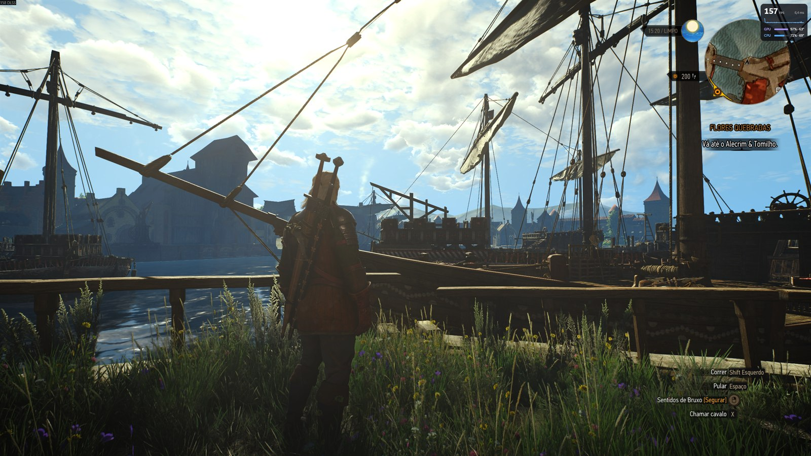
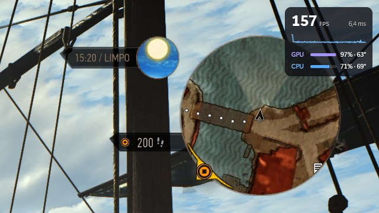
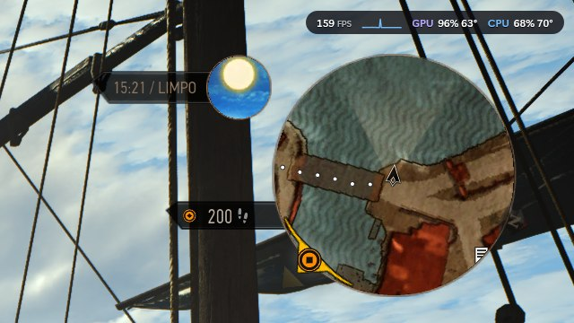
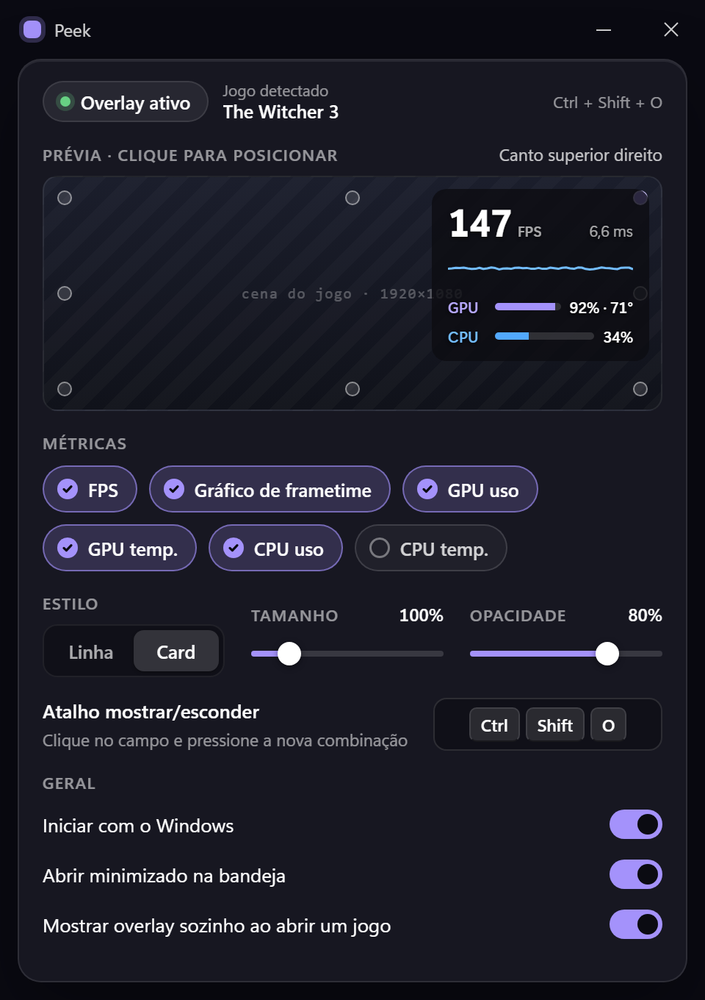

<p align="center">
  
</p>

<h1 align="center">Peek</h1>

<p align="center">
  A lightweight in-game performance overlay for Windows.
</p>

<p align="center">
  
  
  
  
</p>

---

The game starts to stutter and you want to know *why*: is it the GPU, the CPU, or just the frame pacing? Press **Ctrl + Shift + O** and Peek drops a small panel over the game with FPS, a frametime graph, and GPU / CPU usage and temperatures. Press it again and it's gone.

It lives in the tray, starts with Windows, and stays out of the way. When a game takes over the screen it can show itself; when you Alt+Tab away it hides; and the hotkey always wins.

No DLL injection. No DirectX hooks. No reading game memory. Everything comes from what Windows and the drivers already publish.

> *just a peek.*

Rust engine + Tauri 2 shell. Software-rendered Direct2D overlay. Settings in a WebView2 window that only exists while it's open. UI in Brazilian Portuguese.

<p align="center">
  
</p>

## Status

Personal project, used on Windows 11 x64 with an AMD Ryzen 7 5800X and an NVIDIA RTX 4070 Ti, validated in The Witcher 3 against Steam's overlay. Other hardware should work (AMD/Intel GPUs fall back to Windows' counters), but isn't tested.

## What's inside

**Two styles.** A thin **line** that barely covers anything, or a **card** with a big FPS number, a frametime graph and usage bars. Eight positions (corners and edge centers — never the middle of the screen, where your crosshair is), size from 75 % to 200 %, adjustable background opacity. The settings preview is drawn with the exact same rules as the real overlay, so what you see is what you get.

**Real frame numbers.** FPS and frametime come from the same Windows ETW present events [PresentMon](https://github.com/GameTechDev/PresentMon) uses, filtered to the game's process. The graph keeps the worst frame of each column, so stutters show up instead of being averaged away, and the Y axis scales itself.

**GPU usage that matches Steam.** On NVIDIA cards it reads NVML — the same number Steam's overlay, MSI Afterburner and RivaTuner show. Other GPUs use Windows' engine counters (the Task Manager number). GPU temperature comes from D3DKMT, also the Task Manager source.

**CPU temperature, optional.** Reading it needs the signed [PawnIO](https://pawnio.eu/) driver. If it isn't there, the *CPU temp.* pill says *requer driver*; one click installs the official package through `winget`.

**Knows when you're playing.** A window that covers its monitor and keeps presenting frames for ~2 s becomes *the game*: its name shows in the settings, the overlay can appear by itself, and FPS follows that process. Browsers and the shell are ignored. Everything is event-driven — focus changes, window moves, process exit — not polling.

**Light when idle.** Hidden, Peek is a tray icon and a sleeping thread: ~10 MB and 0 % CPU, no timers, no ETW session. The settings window is created when you open it and destroyed when you close it, taking its WebView2 processes with it.

**Rebindable hotkey.** Click the field, press a new combination. Shortcuts already taken by another app — or known to clash with Discord, Steam, NVIDIA or Xbox Game Bar — are refused with a message instead of silently failing.

<table>
  <tr>
    <td width="50%"></td>
    <td width="50%"></td>
  </tr>
  <tr>
    <td align="center"><em>Card — FPS, frametime graph, usage bars</em></td>
    <td align="center"><em>Line — the minimal one</em></td>
  </tr>
</table>

<p align="center">
  
  <br />
  <em>Settings — one screen, no menus, live preview</em>
</p>

## Measured

Release build, elevated, on the machine above (`scripts/measure.ps1`, private working set):

| Situation | Memory | CPU |
|---|---|---|
| Hidden in the tray | 8–12 MB | 0 % |
| Overlay visible over The Witcher 3 | ~32 MB (NVML loaded) | ~0.2 % |
| After closing the settings window | back to ~12 MB, 0 WebView2 processes | 0 % |

NVML is loaded only while the overlay is on screen and released when it hides. Turning the overlay on doesn't change the game's average FPS in any noticeable way.

## Install

Build the installers (below) and run `Peek_0.1.0_x64-setup.exe` or `Peek_0.1.0_x64_en-US.msi`. Both install per machine and ask for administrator rights — see [why](#why-administrator).

Uninstalling removes the app and its *Peek* logon task. Your settings stay in `%APPDATA%\Peek\settings.json`.

## Build

You need Windows 11 x64, [Rust](https://rustup.rs/) stable (`x86_64-pc-windows-msvc`), Node 24+, the Visual Studio 2022 Build Tools (C++), and the WebView2 runtime (already on Windows 11).

```powershell
npm install
npx tauri build
```

The installers land in `target/release/bundle/nsis/` (`.exe`) and `target/release/bundle/msi/` (`.msi`).

### Develop

```powershell
npm run dev        # settings UI only, in the browser, with a mock backend
npx tauri dev      # the whole app (debug build, not elevated)
cargo test --workspace
npm test
```

The debug build runs without elevation, so the things that need it (FPS, CPU temperature) show as unavailable there. The mock accepts URL states for the UI's edge cases: `?driver=missing|failed|installed`, `?igpu=1`, `?nogame=1`, `?hotkeyError=1`, `?installFails=1`.

## Why administrator

The real-time ETW session that delivers present events (the FPS) and the PawnIO driver both require an elevated process, so the release build ships with a `requireAdministrator` manifest and Windows shows UAC when you open it by hand. *Start with Windows* registers a scheduled task that launches Peek elevated at logon, so you don't get a prompt on every boot.

## Limitations

- **Exclusive fullscreen** can't be overlaid by a separate window. Most DX11/DX12 games on Windows 11 run in a mode that allows it; if one doesn't, use borderless.
- **FPS needs DXGI or D3D9.** Vulkan and OpenGL games show "—" for now.
- **Game detection is a heuristic.** An unusual fullscreen app might be taken for a game.

## How it's built

```
crates/engine   Rust, no Tauri: settings, hotkey, ETW frame capture, sensors
                (PDH, NVML, D3DKMT, PawnIO), game detection state machine,
                Direct2D overlay window, the Controller that ties it together
src-tauri       Tauri 2 shell: tray, single instance, settings window, commands/events
src             Preact + TypeScript settings screen, recreated from a design handoff
```

The design spec, the implementation plan and the settings-screen handoff live in [`docs/`](docs/).

## Credits & licenses

- Overlay idea from [ResetExplode](https://github.com/GustavoReset/ResetExplode); frame timing approach from [PresentMon](https://github.com/GameTechDev/PresentMon); temperature reading reference from [LibreHardwareMonitor](https://github.com/LibreHardwareMonitor/LibreHardwareMonitor).
- The executable embeds two signed PawnIO modules, `AMDFamily17.bin` and `IntelMSR.bin`, unmodified from release `0.2.11` of [namazso/PawnIO.Modules](https://github.com/namazso/PawnIO.Modules). They are licensed under the **GNU LGPL 2.1 or later** (`SPDX-License-Identifier: LGPL-2.1-or-later`); license text at <https://github.com/namazso/PawnIO.Modules/blob/0.2.11/COPYING>, source (`AMDFamily17.p`, `IntelMSR.p`) at tag [`0.2.11`](https://github.com/namazso/PawnIO.Modules/tree/0.2.11). Hashes in [`crates/engine/resources/pawnio/README.md`](crates/engine/resources/pawnio/README.md).
